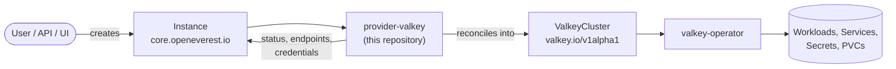

# provider-valkey

> [!WARNING]
> **Pre-alpha.** OpenEverest v2 and this provider are under active development. CRD schemas,
> chart values and defaults change frequently, including in breaking ways, and there is no
> supported upgrade path between versions yet. Not for production use.

[](https://github.com/openeverest/openeverest)
[](https://github.com/openeverest/provider-valkey/actions/workflows/ci.yaml)
[](https://github.com/openeverest/provider-valkey/releases)
[](https://pkg.go.dev/github.com/openeverest/provider-valkey)
[](LICENSE)

Run **Valkey** on Kubernetes through [OpenEverest](https://github.com/openeverest/openeverest),
backed by the [`valkey-operator`](https://github.com/valkey-io/valkey-operator).

## What this is

OpenEverest providers translate a single, technology-agnostic `Instance` custom resource into
the native custom resources of an upstream Kubernetes operator — for databases, but equally
for caches, message queues, object storage, or model-serving runtimes. This repository is the
provider for Valkey: it owns the technology-specific knowledge — topologies, versions,
parameters, TLS and authentication wiring — so that users, the API server, and the UI stay
technology-agnostic.

> [!IMPORTANT]
> **This provider is not standalone.** It requires an OpenEverest installation (core CRDs and
> controller) in the cluster. Installing this chart on its own does nothing.
> See [Install OpenEverest](https://openeverest.io/documentation/current/quick-install.html).



The provider watches `Instance` resources whose `spec.providerRef.name` is `valkey`, and
reports workload health back onto `Instance.status`. It never manages pods directly — all
lifecycle work is delegated to the operator.

## Compatibility

| provider-valkey | OpenEverest | valkey-operator | Kubernetes |
|---|---|---|---|
| `0.2.x` | `2.0.0-alpha.1` | `0.9.0` | `1.31` – `1.33` |
| `0.1.x` | `>= 2.0.0` | `0.6.0` | `1.30` – `1.33` |

## Capabilities

What you can do to a running instance through the `Instance` API. Upgrading the
provider itself is covered under [Installation](#installation).

| Capability | Status | Notes |
|---|---|---|
| Provisioning | ✅ | Cluster and replication topologies |
| Horizontal scaling | ✅ | Shards (cluster) and replicas per shard |
| Vertical scaling (CPU / memory) | ✅ | Per-component `resources` |
| Version upgrades | ✅ | Select a version bundle with `spec.version` |
| Custom configuration | ✅ | Passthrough Valkey config via engine `parameters.config` |
| Monitoring | ✅ | Metrics through OpenEverest monitoring destinations (exporter sidecar, run on demand); see [Monitoring](#monitoring) |
| TLS | ✅ | On by default: a CA of the instance, a cert-manager issuer, or a certificate Secret of your own |
| Mutual TLS | ✅ | Optional or required client certificates; a client certificate is issued for the default user |

Stateful workloads additionally report:

| Capability | Status | Notes |
|---|---|---|
| Persistent storage | ✅ | Per-component `storage.size` |
| Storage expansion | ❌ | |
| Backups (on demand) | ❌ | |
| Backups (scheduled) | ❌ | |
| Point-in-time recovery | ❌ | |
| Restore | ❌ | |

The default user is always password-protected: the provider generates a password, stores it in
a per-instance Secret, and exposes it in the connection details.

## Installation

The provider chart is published as an OCI artifact:

```bash
helm install provider-valkey \
  oci://ghcr.io/openeverest/charts/provider-valkey \
  --version <chart-version> \
  --namespace everest-system
```

- The `valkey-operator` is bundled as a chart dependency and is installed automatically
  (disable with `--set operator.enabled=false` to use an operator you already run).
- [cert-manager](https://cert-manager.io) is needed only for instances whose certificates an
  issuer issues (`spec.parameters.tls.issuer`, see [TLS](#tls)).
- The chart registers an admission webhook, so an invalid `Instance` is rejected when it is
  written, with every error and its field path. Its serving certificate is generated by the
  chart and kept across upgrades; set `admission.certManager.enabled=true` to have
  cert-manager issue it, or supply one through `admission.certs`. If the provider is down,
  writes are admitted and the `Instance` reports the errors in its `Ready` condition.
  Problems with other objects, such as a missing user Secret named by `spec.userSecretRef`,
  are never a reason to reject it: `kubectl` prints a warning, and the `Instance` reports
  them once created.

Upgrade and uninstall:

```bash
helm upgrade provider-valkey oci://ghcr.io/openeverest/charts/provider-valkey
helm uninstall provider-valkey --namespace everest-system
```

> Browse available versions on the
> [chart package page](https://github.com/openeverest/provider-valkey/pkgs/container/charts%2Fprovider-valkey).

Helm does not upgrade the CRDs of the bundled `valkey-operator`. When an upgrade moves to a
new operator version, apply its CRDs first, otherwise the operator cannot finish rolling the
clusters:

```bash
helm pull oci://ghcr.io/openeverest/charts/provider-valkey --version <chart-version> --untar
tar -xzf provider-valkey/charts/valkey-operator-*.tgz -O valkey-operator/crds/ \
  | kubectl apply --server-side --force-conflicts -f -
```

Upgrading to valkey-operator `0.7.x` rolls every Valkey pod once, and `cluster-node-timeout`
moves to the Valkey default of 15 seconds unless set via
`components.engine.parameters.config`.

Upgrading to valkey-operator `0.8.x` does not roll the pods, but the CRD step above is
required: with the `0.7.x` ValkeyNode CRD the API server silently drops the new
`podMetadata` and `serviceAccountName` fields. `0.8.x` also rejects every update to a
`ValkeyCluster` whose name is too long for its StatefulSets (41 characters with single-digit
shard and replica indexes), including the operator's status writes. The provider fails
validation of such an `Instance` with the length its shards and replicas allow. List the
affected instances before upgrading:

```bash
kubectl get valkeycluster -A -o json | jq -r '.items[] | select((.spec.workloadType // "StatefulSet") == "StatefulSet" and (.metadata.name | length) > 41) | "\(.metadata.namespace)/\(.metadata.name)"'
```

Upgrading to valkey-operator `0.9.x` rolls every Valkey pod once, one at a time, failing over
before each primary. **An instance with no replicas and no persistent storage loses its data on
that roll.** Apply the CRDs **before** `helm upgrade`: the provider now writes
`spec.replicasPerShard` and `spec.acl.users` in place of the deprecated `spec.replicas` and
`spec.users`, and the `0.8.x` CRD prunes the new fields, which leaves the clusters without
replicas and without the password-protected `default` user. If the CRDs were applied after
the upgrade, restart the operator Deployment so that it picks them up. With
`operator.enabled=false`, upgrade the operator to `0.9.x` before the provider. The generated
ACL does not change, so clients keep authenticating as `default` with the same password. A
custom engine image must run without privilege escalation, which the operator now disallows.
The provider rejects a new `Instance` whose name contains a dot, which `0.9.x` rejects as a
`ValkeyCluster` name.

The provider labels the Valkey pods with the OpenEverest pod labels (`core.openeverest.io/instance`,
`core.openeverest.io/component`, `core.openeverest.io/provider`) through the `ValkeyCluster`'s
`podMetadata`, so the `Instance` status reports its pods. Upgrading from a provider version that
did not set them rolls every Valkey pod once. With replicas, the operator fails over before it
rolls a primary. **An instance with no replicas and no persistent storage loses its data on that
roll**: add a replica or back the data up before upgrading.

**Pod security.** The provider, the operator and the Valkey pods pass the `restricted` Pod
Security Standard and OpenShift's default `restricted-v2` SCC. Valkey pods run as the image's
`valkey` user (UID/GID 999, `fsGroup` 999) with seccomp `RuntimeDefault` and all capabilities
dropped. On OpenShift, detected through the `security.openshift.io` API group, the IDs are left
to the SCC. Earlier releases ran Valkey as root: upgrading rolls every Valkey pod once, as above,
and the first start hands the data volume over to the valkey group.

**Monitoring moved to OpenEverest monitoring destinations.** The provider no longer creates
`PodMonitor`s or `VMPodScrape`s, and on upgrade it deletes the ones earlier releases created
(`<instance>-metrics`, `<instance>-prometheus`, `<instance>-victoriametrics`, and the
`VMPodScrape`s the VictoriaMetrics Operator converted from the `PodMonitor`s). To keep
collecting metrics, list a destination on each Instance (see [Monitoring](#monitoring)). The
`metrics.prometheus.enabled` and `metrics.victoriaMetrics.enabled` parameters of the
`monitoring` component are deprecated and ignored, but still accepted. The chart values
`podMonitor.labels` and `vmPodScrape.labels` are gone. Instances with the `monitoring`
component keep running the exporter, so their pods do not roll.

Uninstalling the chart does **not** delete running `Instance` resources or their data.

## Usage

Verify that the provider registered itself:

```bash
kubectl get providers.core.openeverest.io valkey
```

Create an instance:

```yaml
apiVersion: core.openeverest.io/v1alpha1
kind: Instance
metadata:
  name: my-valkey
spec:
  providerRef:
    name: valkey
  topology:
    type: replication
  components:
    engine:
      type: valkey
      replicas: 1
      resources:
        requests:
          cpu: 500m
          memory: 2G
      storage:
        size: 10Gi
```

Component names are defined by this provider — see [definition/provider.yaml](definition/provider.yaml).
`spec.version` and `spec.topology` are optional; the provider defaults apply.
More examples live in [examples/](examples/).

Watch it come up and read the connection details:

```bash
kubectl get instance my-valkey -w
kubectl get instance my-valkey -o jsonpath='{.status.connection}'
```

The default user's generated password is included in the connection details and in the
per-instance auth Secret.

### Status

The provider reports what it observes, and OpenEverest derives the `Instance` conditions from
it the same way for every provider.

| Condition | What this provider reports |
|---|---|
| `Available` | `True` while every shard that serves hash slots has a Valkey node that reports the primary role. The operator records each node's role on its `ValkeyNode`, asking the node itself, and clears it as soon as the node's pod is not ready. Otherwise `False`, with reason `NoPrimary`, for example between the loss of a primary and the failover to its replica, or `SlotsUnassigned` while the operator finds hash slots that no primary serves. Before the operator has assigned the slots for the first time, it is `False` while the instance is created. |
| `Ready` | `True` once the cluster runs what the `Instance` asks for: the operator reports the `ValkeyCluster` ready, and not degraded, for its latest generation, and every `ValkeyNode` runs the cluster's image and volume size, is ready and has a volume of the requested size. Until then the message says what is being waited for, in the operator's words where it has any. |
| `Upgrading` | `True` while the operator moves the Valkey nodes to a new image. |
| `StorageResizing` | `True` while the volumes of the Valkey nodes grow to a new size. |

The connection details Secret is written the first time the database is available, and kept
current while a change rolls out.

The `engine` component reports `desiredReplicas`, the Valkey pods it will have once the cluster runs the `Instance`'s current spec: a primary and its replicas in every shard, with one shard for `replication` and 3 for `cluster` unless `numShards` is set, and no replicas unless set. `monitoring` runs as a sidecar in those pods and is not reported.

A problem makes the `Instance` not `Ready`, with the operator's reason:

| Reason | Cause |
|---|---|
| `ServiceError`, `PodDisruptionBudgetError`, `ConfigMapError`, `TrustBundleError`, `UsersACLError`, `SystemUsersACLError`, `ValkeyNodeError`, `ValkeyNodeListError` | A step of the operator's pass over the cluster failed; the message quotes the error. |
| `OperatorAuthenticationFailed` | A Valkey node rejects the password the operator logs in with. |
| `NodeAddFailed`, `RebalanceFailed` | The operator could not add a node to the cluster, or move hash slots between shards. |
| `ScaleInBlocked` | A scale-in waits for something the operator cannot fix by itself. |
| `ACLApplyFailed`, `UsersACLUnresolved` | The users and passwords the operator manages are not in effect on every node. |
| `ResizeFailed` | A volume cannot grow to the requested size. |

A write that conflicted with another one is not a problem, because the operator retries it on
its next pass. Pods that cannot be scheduled are reported by OpenEverest from the pods
themselves.

What the provider cannot know:

- **Availability is as fresh as the operator's view of the nodes.** The operator polls the
  roles every few seconds and follows the pods, but whether the cluster as a whole serves
  requests (`cluster_state`) is not published.
- **A shard added by a scale-out counts as soon as its `ValkeyNode`s exist**, so availability
  reads `False` (`NoPrimary`) until the new primary's pod is ready, although the shard does
  not serve any hash slots yet.
- **Hash slots are checked on the operator's passes.** After every node of a cluster without
  persistent storage restarted empty, availability reads `True` as soon as the nodes are
  ready, before the operator has assigned their slots again.
- **`Upgrading` ends once every node has the new image in its spec**, while the last pod may
  still be restarting; the `Instance` is `Ready` only after that.
- **Problems are reported for the latest generation only.** The operator stamps its
  conditions with the generation it acted on, and an error from an earlier one may be fixed by
  the change just applied.

## Topologies

| Topology | Default | Description |
|---|---|---|
| `replication` | ✅ | Single shard: one primary with zero or more read replicas |
| `cluster` | | Multiple shards (minimum 3), data partitioned across primaries |

Both topologies run Valkey in cluster mode, so replicas answer writes with `MOVED`. Clients of
the `replication` topology connect to the `valkey-<instance>-primary` Service, which the
provider points at the current primary and re-points after a failover; any Redis client works
against it. `cluster` clients connect to the headless `valkey-<instance>` Service and must be
cluster-aware. TLS instances created before the primary Service existed keep the headless
Service in their connection details, because their certificate does not cover the new name;
regenerate their TLS material (see below) to switch.

## Presets

The chart installs cluster-scoped `ClusterInstancePreset` resources that pre-fill common
instance shapes in the UI's create wizard (list them with
`kubectl get clusterinstancepresets.core.openeverest.io`). They pin the default version
bundle (`9.0`):

| Preset | Topology | Shape |
|---|---|---|
| `valkey-dev` | `replication` | Standalone primary, 1 CPU / 1Gi, 5Gi disk |
| `valkey-prod-replication` | `replication` | Primary + 2 replicas, 2 CPU / 4Gi, 25Gi disk |
| `valkey-prod-cluster` | `cluster` | 3 shards × (primary + 1 replica), 2 CPU / 4Gi, 25Gi disk |

Change, add or disable them under `presets` in
[charts/provider-valkey/values.yaml](charts/provider-valkey/values.yaml). Each entry has a
`name` (prefixed with `provider.shortName`), `enabled`, and the Instance `spec` it
creates. The chart sets `spec.providerRef`. Presets are cluster-scoped, so they must not
reference namespaced objects such as Secrets. For example, to install only `valkey-dev`:

```bash
helm upgrade provider-valkey <chart> -n <namespace> \
  --set presets[1].enabled=false --set presets[2].enabled=false
```

Users create their own namespaced `InstancePreset`s; the provider no longer ships those.

## Versions

| Version bundle | Default | valkey |
|---|---|---|
| `9.1` | | `9.1.2` |
| `9.0` | ✅ | `9.0.6` |
| `8.1` | | `8.1.1` |

Source of truth: [definition/versions.yaml](definition/versions.yaml).

## Configuration

- **Chart values:** [charts/provider-valkey/values.yaml](charts/provider-valkey/values.yaml)
- **Instance parameters:** per-component and per-topology `parameters` schemas, defined under
  [definition/](definition/) and published on the `Provider` resource
  (`kubectl get provider valkey -o yaml`). The provider rejects an Instance that does not
  match them, and the UI checks the form against them as you type.
- **Resources in the UI:** CPU, memory and disk are `quantity` fields: you enter a number
  and the UI writes a Kubernetes quantity. Engine CPU is in cores, fractions included
  (`1.5` is written as `"1.5"`), engine memory and disk in Gi; the exporter sidecar's CPU is
  in millicores and its memory in Mi. A value you leave unchanged keeps its stored form
  (`8192Mi` is not rewritten as `8Gi`). This needs an OpenEverest release after
  `2.0.0-dev.4`: an older UI does not know the field type.
- **Cluster domain:** clusters whose kubelet runs with a `--cluster-domain` other than
  `cluster.local` need `--set clusterDomain=<domain>` (the `CLUSTER_DOMAIN` environment
  variable, or the provider's `--cluster-domain` flag). The provider uses it for the connection
  host, the names of the certificates it issues and the ValkeyCluster's
  `networking.clusterDomain`. Certificates already issued by the provider's CA are not
  reissued: after changing the domain, delete the `<instance>-tls` Secret of each TLS instance
  and restart its Valkey pods; this regenerates the instance CA too, so clients must fetch the new
  `ca.crt`. With an `issuer`, cert-manager reissues the certificate for the
  new names; see **Renewal** under [TLS](#tls) for when the pods pick it up.

Technology-specific knobs:

- **Engine config** — arbitrary Valkey config keys via `components.engine.parameters.config`
  (e.g. `maxmemory-policy`). Operator-managed keys (port, TLS, ACL) are ignored.
- **TLS** — on by default; configured in `spec.parameters.tls`, see [TLS](#tls).
- **Cluster shards** — set `topology.parameters.numShards` (cluster topology only, minimum 3).

## TLS

TLS is configured in `spec.parameters.tls`, the shape shared by OpenEverest providers:

```yaml
spec:
  parameters:
    tls:
      mode: requireTLS               # or disabled
      issuer:                        # cert-manager issues the certificates
        name: company-ca
        kind: ClusterIssuer          # default Issuer; group defaults to cert-manager.io
      # certificateSecretName: my-cert  # or serve the certificate of a Secret
      additionalNames: [cache.example.com]
      clientAuth: optional           # optional (default), required or disabled
      certificateUser: cn            # log a client certificate in as its CN user (Valkey 9.0+)
```

| Field | Default | Notes |
|---|---|---|
| `mode` | `requireTLS` | `requireTLS` serves TLS only; `disabled` serves plain text. Cannot change once the instance is created: valkey-operator (as of v0.9.0) has no way to switch a running cluster. |
| `issuer` | | A cert-manager `Issuer` (in the instance namespace) or `ClusterIssuer`, or an external issuer of `group`. The provider creates the `<instance>-tls-server` and `<instance>-tls-client` Certificates. Needs cert-manager. |
| `certificateSecretName` | | A Secret of yours with `tls.crt`, `tls.key` and `ca.crt`, in the instance namespace. Not with `issuer`. |
| `additionalNames` | | DNS names (wildcards allowed) the server certificate covers besides the instance's, e.g. those of a load balancer. Not with `certificateSecretName`. |
| `clientAuth` | `optional` | See [Mutual TLS](#mutual-tls). |
| `certificateUser` | | `cn`: see [Mutual TLS](#mutual-tls). |

Without `issuer` or `certificateSecretName`, the provider creates a CA for the instance
(`<instance>-tls-ca`, whose key is never mounted into the Valkey pods) and issues the server
certificate (`<instance>-tls`) from it. The certificate source cannot change once the instance is
created, nor can the issuer: the nodes and the clients trust the CA they started with.

**Your own certificate.** The certificate of `certificateSecretName` must be valid for both
server and client authentication, since the nodes also present it to each other, and must cover
the names valkey-operator and cluster clients connect by (shown with the default
[cluster domain](#configuration), `cluster.local`): `valkey-<instance>.<namespace>.svc.cluster.local`
and its subdomains (`*.valkey-<instance>.<namespace>.svc.cluster.local`, one per pod). Add
`valkey-<instance>-primary.<namespace>.svc.cluster.local` for clients of the `replication`
topology. With the metrics exporter, it must cover `localhost` too: redis_exporter (as of
v1.80.0) verifies the certificate for the host it connects to. The provider checks the Secret,
when it exists, and waits for it otherwise. For example, with a CA of your own:

```bash
fqdn=valkey-mycache.team-a.svc.cluster.local
openssl req -new -newkey rsa:2048 -nodes -keyout tls.key -subj "/CN=$fqdn" -out tls.csr
openssl x509 -req -in tls.csr -CA ca.crt -CAkey ca.key -CAcreateserial -days 365 -out tls.crt \
  -extfile <(printf "subjectAltName=DNS:%s,DNS:*.%s,DNS:valkey-mycache-primary.team-a.svc.cluster.local,DNS:localhost\nextendedKeyUsage=serverAuth,clientAuth" $fqdn $fqdn)
kubectl -n team-a create secret generic mycache-cert --from-file=tls.crt --from-file=tls.key --from-file=ca.crt
```

**Renewal.** Valkey 9.1 and later reload a renewed certificate: for an `issuer` or a
`certificateSecretName`, the provider sets `tls-auto-reload-interval` to `3600` seconds unless
`components.engine.parameters.config` sets it. Valkey before 9.1 reads the certificate when it
starts, so restart the pods after a renewal (the provider warns when such an instance is created
or updated). The provider's CA issues long-lived certificates.

**Additional names.** Changing `additionalNames` on a running instance reissues the server
certificate, which the pods present once they restart. The provider asks for a `RollingRestart`
maintenance (`status.pendingMaintenance`, token `tls-names-<hash>`) and restarts the pods once it
is approved. Instances created before the provider kept the CA key cannot have additional names
issued: delete their `<instance>-tls` Secret to regenerate the TLS material, then restart the
Valkey pods.

### Mutual TLS

`clientAuth` is `optional` (default), `required`, or `disabled`. The provider issues a client
certificate (`CN=default`), from the instance CA or the issuer, and publishes it as `tls.crt` /
`tls.key` in the connection details (and in the `<instance>-tls-client` Secret; none for a
`certificateSecretName`). With `certificateUser: cn` (Valkey 9.0+) that certificate logs the
client in as the `default` user without a password:

```bash
valkey-cli --tls --cacert ca.crt --cert tls.crt --key tls.key -h <host> ACL WHOAMI
```

Instances created before the CA key was kept cannot issue client certificates: delete their
`<instance>-tls` Secret to regenerate the TLS material, then restart the Valkey pods.
Tightening `clientAuth` to `required` on a running instance is supported; relaxing it from
`required` is rejected, because valkey-operator (as of v0.9.0) stops presenting its client
certificate before the nodes stop requiring one and loses access to the cluster.

### Upgrading from `components.engine.parameters.tls`

Releases before this one took TLS in `components.engine.parameters.tls`, which is no longer
accepted: an Instance that still sets it fails validation until it is moved. Move the block to
`spec.parameters.tls`; `mode`, `clientAuth` and `certificateUser` keep their meaning. An
instance created with `mode: disabled` must keep it, since TLS is now on by default:

```bash
kubectl -n team-a patch instance mycache --type=json -p '[
  {"op":"add","path":"/spec/parameters","value":{"tls":{"mode":"disabled"}}},
  {"op":"remove","path":"/spec/components/engine/parameters/tls"}]'
```

(If the instance already has `spec.parameters`, add `/spec/parameters/tls` instead.) Instances
that used the default need no change beyond removing the old block.

## Monitoring

Monitoring is an OpenEverest extension. The provider declares that Valkey's metrics come from
an exporter (the `valkey` component type, `kind: valkey`, `metrics: Exporter`) and publishes
the exporter's endpoint in `Instance.status.monitoring.sources`; the extension behind a
monitoring destination creates the scrape objects. To send an instance's metrics somewhere:

1. Install a monitoring extension, such as
   [monitoring-prometheus](https://github.com/openeverest/monitoring-prometheus), and check
   that its class is accepted: `kubectl get monitoringclass`.
2. Create a `MonitoringDestination` of that class in the instance's namespace.
3. List it on the Instance, or add it from the UI's **Edit monitoring** dialog:

   ```yaml
   spec:
     monitoring:
       destinations:
         - name: metrics
           destinationRef:
             name: prometheus
   ```

Core creates a `MonitoringBinding` per entry. While a bound class needs metrics, the provider
runs the [redis_exporter](https://github.com/oliver006/redis_exporter) sidecar of the
instance's version bundle in every Valkey pod and publishes its endpoint (port `metrics`,
`/metrics`) once a pod serves it. Adding the sidecar, and removing it when the last such
destination goes, rolls the Valkey pods; core reports this as the `RollingRestart` disruption
on the class.

To scrape the exporter with a Prometheus you run yourself, add the optional `monitoring`
component instead ("Metrics exporter" in the UI). It runs the sidecar whatever the
destinations, with the image, version and resources you give it:

```yaml
spec:
  components:
    monitoring:
      type: exporter
      resources:
        limits:
          cpu: 100m
          memory: 128Mi
```

Its `metrics.prometheus.enabled` and `metrics.victoriaMetrics.enabled` parameters are
deprecated and ignored: earlier releases created a `PodMonitor` or `VMPodScrape` from them.

## Development

Requires Go (see [go.mod](go.mod)), Docker, Helm, kubectl, and a Kubernetes cluster you can
reach. [dev/README.md](dev/README.md) covers the environment end to end: the recommended
local k3d setup, running against a cluster you already have, and every `dev/.env` setting.

```bash
make dev-up             # local k3d cluster + Tilt dev environment (see dev/README.md)
make generate           # RBAC, provider spec, Helm chart sync
make run                # run the provider locally against the cluster
make test               # unit tests
make test-integration   # chainsaw suites under test/integration/
make dev-down           # stop Tilt (keeps the cluster)
```

`make help` lists every target. `make verify` fails when generated files are stale — run
`make generate` and commit the result.

The provider contract (`Validate` / `Sync` / `Status` / `Cleanup`), RBAC markers, watches,
code generation, and the backup/restore interfaces are documented once for all providers in
[PROVIDER_DEVELOPMENT.md](https://github.com/openeverest/provider-sdk/blob/main/PROVIDER_DEVELOPMENT.md).

### Layout

| Path | Purpose |
|---|---|
| `cmd/provider/` | Entry point |
| `internal/provider/` | `ProviderInterface` implementation, TLS and auth wiring, RBAC markers |
| `internal/common/` | Component name constants |
| `definition/` | Provider identity, component types, versions, topologies |
| `charts/provider-valkey/` | Helm chart (`generated/` is produced by `make generate`) |
| `config/rbac/role.yaml` | Generated `ClusterRole` — do not edit |
| `test/integration/` | Chainsaw suites (cluster and replication) |
| `test/e2e/` | Chainsaw suites against the chart-installed provider and the real operator |
| `test/vars.sh` | Pinned operator and workload versions used by tests |
| `examples/` | Example `Instance` resources |
| `dev/` | Tilt dev environment, `.env` configuration, k3d cluster config |
| `.github/workflows/` | CI: lint, build, unit and integration tests, release |

### Testing

- **Unit tests** — `make test`.
- **Integration tests** — chainsaw suites under [test/integration/](test/integration/),
  exercising the cluster and replication lifecycles against a running cluster. The
  valkey-operator is not deployed: the suites write the status of its `ValkeyCluster` and
  `ValkeyNode` objects. The OpenEverest CRDs come from the core revision pinned in `go.mod`
  (`make install-test-crds`). The admission suite needs the provider installed from the chart as `provider-valkey` in
  `provider-system`, so `make test-integration` skips it; run it with
  `make test-integration-admission`.
- **E2E tests** — suites under [test/e2e/](test/e2e/) (`presets`, `monitoring`) and the admission suite,
  which need the provider installed from its chart, with the valkey-operator, and the
  OpenEverest controller running:

  ```bash
  make k3d-cluster-up
  make docker-build load-image IMG=provider-valkey:ci
  # In an openeverest/openeverest checkout:
  make docker-build-controller
  make load-openeverest-controller-image
  make install-test-crds
  make deploy-provider-e2e IMG=provider-valkey:ci
  # In the openeverest/openeverest checkout:
  make deploy-test-controller
  make test-integration-admission
  make test-e2e-presets
  make test-e2e-monitoring
  ```
- **CI** — `.github/workflows/ci.yaml` runs lint, build, unit tests, and generated-file
  verification; `.github/workflows/integration-test.yaml` runs the integration suites;
  `.github/workflows/e2e-test.yaml` runs the e2e suites, with the OpenEverest controller
  built from `OPENEVEREST_BRANCH` of openeverest/openeverest (core `main` until the next
  core release).

## Troubleshooting

```bash
kubectl logs -n everest-system deploy/provider-valkey -f
```

| Symptom | Where to look |
|---|---|
| `Instance` stuck in `Creating` | `kubectl describe instance <name>` conditions, then the provider logs |
| No `Provider` resource in the cluster | Is the chart installed? Check the provider deployment logs |
| `Instance` ignored entirely | `spec.providerRef.name` must be `valkey` |
| `ValkeyCluster` created but no pods | Inspect the `ValkeyCluster` status — the failure is upstream in the operator |

## Contributing

Issues and pull requests are welcome. See
[PROVIDER_DEVELOPMENT.md](https://github.com/openeverest/provider-sdk/blob/main/PROVIDER_DEVELOPMENT.md)
and the [OpenEverest Code of Conduct](https://github.com/openeverest/openeverest/blob/main/CODE_OF_CONDUCT.md).

## Security

Report vulnerabilities per the
[OpenEverest security policy](https://github.com/openeverest/openeverest/blob/main/SECURITY.md).
Please do not open public issues for security reports.

## License

Apache License 2.0 — see [LICENSE](LICENSE) for details.
